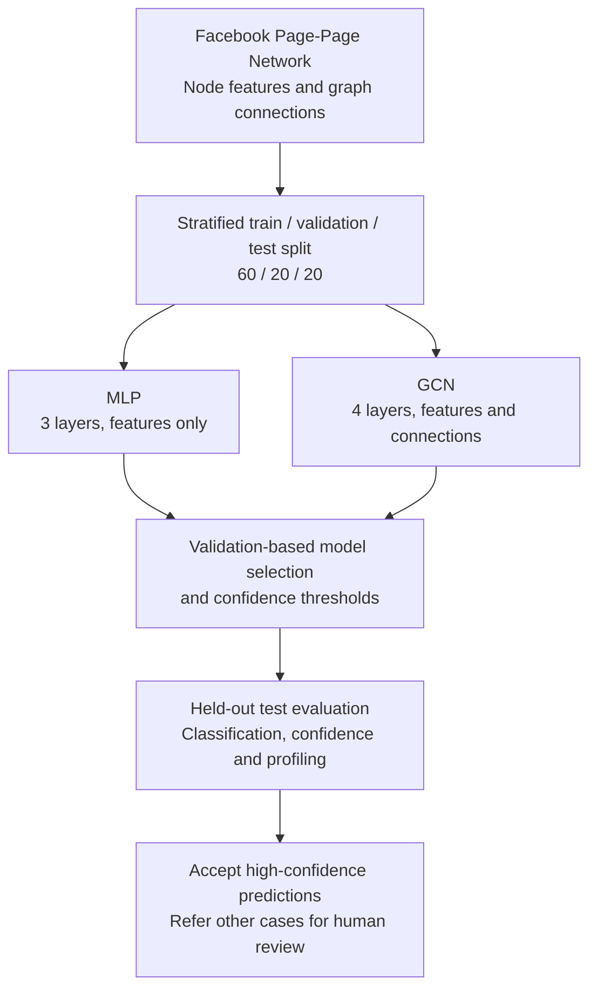
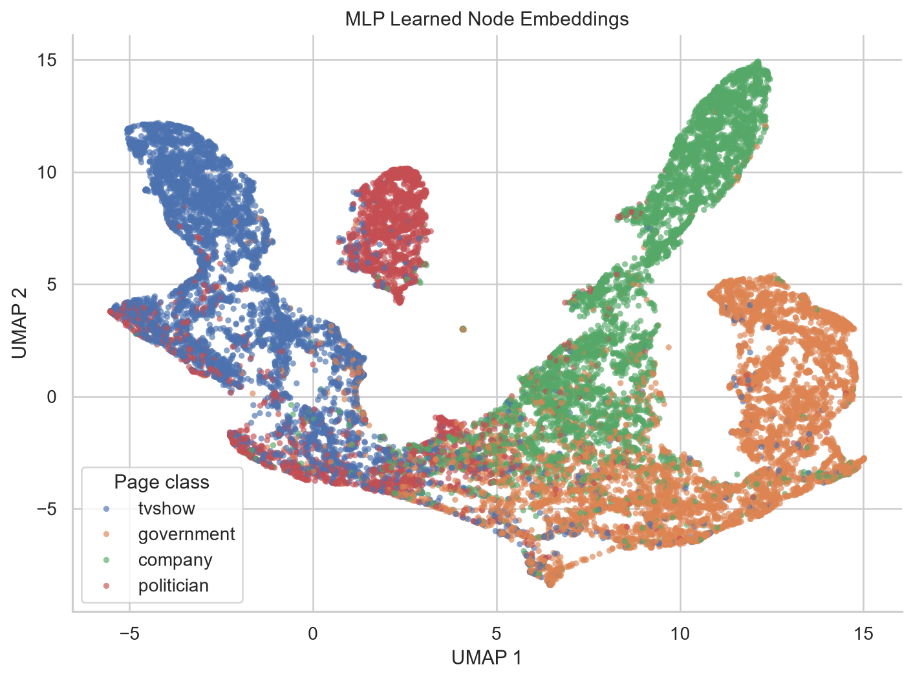
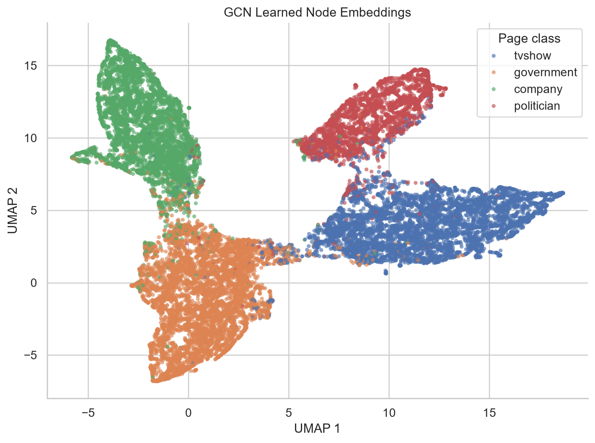

# Multi-Layer GNN for Facebook Page Classification
## COMP3710 Working Prototype Project in the Era of Artificial Intelligence
### Derek McKinney (dm-uq), SN: 45506053

## 1. Project Overview

### 1.1 Problem and Intended User

This project investigates the classification of public Facebook pages into four
categories: television show, government, company and politician. The intended
user is a social-network analyst or reviewer who needs to classify pages
efficiently while identifying uncertain cases that may require closer
examination.

The project compares a feature-only Multi-Layer Perceptron (MLP) with a Graph
Convolutional Network (GCN), which additionally uses connections between
Facebook pages. The main objective is to determine whether the GCN's improved
classification performance and potential reduction in manual review justify its
additional computational cost and complexity.

### 1.2 Algorithm / Working Principle

The Facebook Large Page-Page Network contains 22,470 nodes, each with
128-dimensional features, and 342,004 stored edge entries. A reproducible
stratified 60/20/20 split (seed 808) separates nodes into training, validation
and test sets.

The MLP classifies pages using their node features alone. In contrast, the GCN
applies successive graph-convolution layers to combine each node's features
with information from connected nodes. The final selected architectures are a
three-layer MLP and a four-layer GCN, each independently tuned using validation
results.

Both models are evaluated on the held-out test set using classification
metrics, prediction confidence and computational resource measurements. A
confidence-based reject-option rule is also investigated, where predictions
above a validation-selected threshold are accepted automatically and
lower-confidence predictions are referred for human review.

### 1.3 Project Figure / Overview Diagram

The following diagram summarises the main stages of the project, from data
preparation and model training through to evaluation and confidence-based
classification.



The comparison assesses both classification performance and the practical
trade-off between automated coverage, classification errors and the additional
computational cost of graph-based inference.

## 2. Feasibility Review

### 2.1 User Need, Scope and Acceptance Criteria

The intended user is a social-network analyst or reviewer responsible for
categorising public Facebook pages. Accurate page-type classification can
support downstream trust & safety and network-analysis workflows by helping
analysts identify anomalous or potentially misrepresented pages, prioritise
cases for review, and interpret patterns of coordination across the network.
Manual classification does not scale well to large networks, while fully
automated classification may produce incorrect but highly confident
predictions. The project therefore investigates whether incorporating graph
connectivity through a Graph Convolutional Network (GCN) provides sufficient
practical benefit over a feature-only MLP baseline to justify its additional
complexity and computational cost.

The scope is semi-supervised classification of nodes in the supplied Facebook
Large Page-Page Network into four existing classes: television show,
government, company, and politician. The project uses a transductive setting,
where the complete graph is available during training and access to class
labels is controlled by the train, validation, and test masks. An initial
two-layer GCN provides the starting graph model, after which a limited set of
motivated architectural or training choices may be investigated where they
could improve classification performance, confidence behaviour, or
computational efficiency. Exhaustive hyperparameter optimisation is outside
the project scope.

The prototype does not attempt to discover new classes or demonstrate
generalisation to previously unseen graphs. Resource measurements on the
supplied graph will be used to assess prototype feasibility and inform
discussion of likely scalability constraints, but production-scale deployment
on substantially larger networks is also outside the project scope.

The GCN will be considered a stronger candidate for further development than
the baseline MLP model if it meets the following acceptance criteria:

1. **Classification benefit:** it provides a material improvement over the MLP
   baseline on held-out classification performance, particularly macro-F1 and
   per-class recall, rather than improving only overall accuracy.

2. **Decision-confidence benefit:** at a comparable level of automated coverage
   or human-review workload, the GCN should achieve a lower error rate among
   automatically accepted predictions than the MLP. Conversely, for a specified
   acceptable error level, it should permit equal or greater automated
   coverage. The reject-option analysis will therefore compare the models
   through their risk–coverage trade-off, rather than simply comparing raw
   confidence scores.

3. **Error concentration:** remaining errors should be preferentially
   concentrated among low-confidence or otherwise ambiguous cases, such that
   routing uncertain predictions to human review captures a meaningful
   proportion of classification errors.

4. **Operational feasibility:** the GCN should provide its classification and
   decision-confidence benefits without a disproportionate increase in memory
   use, inference latency, or model complexity relative to the MLP.
   The supplied graph should remain comfortably tractable on the available
   hardware, while measured resource use and expected scaling behaviour should
   not reveal an obvious barrier to applying the approach to moderately larger
   graphs.

If these criteria are not met, the simpler MLP remains a viable fallback and
the additional graph-model complexity would not be recommended solely on the
basis that a GCN can be trained successfully.

### 2.2 Model Choice, Dataset and Difficulty

The project uses the Facebook Large Page-Page Network, represented as a single
PyTorch Geometric graph containing 22,470 Facebook page nodes, 342,004 stored
edge entries, 128-dimensional node features, and four target classes:
television show, government, company, and politician. Preliminary data analysis
found edge homophily of approximately 0.885, meaning connected nodes frequently
share the same class label.

The graph model is a multi-layer Graph Convolutional Network (GCN). An initial
two-layer GCN uses the same 128 → 64 → 4 dimensional structure, ReLU
activation, and dropout setting as the feature-only MLP baseline, but replaces
the linear layers with graph-convolution layers that incorporate neighbourhood
information through the graph structure. The observed level of homophily
(0.885) suggests a practical reason to investigate whether this additional
graph information can improve classification over the feature-only baseline.

The project is classified in the **Normal Difficulty** band. The task goes
beyond straightforward feature-only classification because it uses a
transductive semi-supervised setting and requires graph connectivity to be
exploited without leaking held-out labels. The model must be evaluated not only
for classification performance, but also for confidence behaviour,
reject-option usefulness, resource cost, and representative failure cases.

### 2.3 Relevant Course Concepts and Literature

The project directly applies course material on graph representation and Graph
Neural Networks. A graph is represented through its nodes, edges, and node
features, while GNN message passing combines a node's own representation with
information aggregated from its neighbours. In a GCN, this allows graph
structure to contribute directly to the learned node representation rather than
relying only on the 128-dimensional page features used by the MLP baseline.

The task also reflects the course treatment of semi-supervised node
classification. Successive graph-convolution layers increase the receptive
field by incorporating information from progressively more distant
neighbourhoods. However, the course material also identifies limited GNN depth
and oversmoothing as important design considerations. This provides a reason to
begin with a shallow two-layer GCN and to treat any further increase in depth
as a controlled experiment, rather than assuming that a deeper network will
perform better.

The initial GCN design is supported by Kipf and Welling's formulation of
semi-supervised classification with Graph Convolutional Networks. The planned
confidence and reject-option analysis is informed by El-Yaniv and Wiener's
selective-classification framework, which characterises the trade-off between
prediction risk and automated coverage. Geifman and El-Yaniv apply selective
classification to deep neural networks, providing further support for
evaluating the GCN and MLP through their risk–coverage behaviour. These ideas
provide a basis for assessing the models at matched levels of automated
coverage or acceptable prediction risk, rather than simply comparing raw
confidence scores.

### 2.4 Preliminary Feasibility Evidence

Initial data inspection and model experiments indicate that the proposed
approach is feasible on the supplied dataset and available local hardware. The
Facebook graph has been successfully loaded and audited, and the reproducible
stratified train, validation, and test masks are in place.<br>
Edge homophily is approximately 0.885, meaning that most connected node pairs
share the same class label. This is substantially above the roughly 0.265
same-class rate expected from the observed class proportions under simple
random mixing, providing preliminary evidence that graph connectivity contains
useful class-related structure.

The feature-only MLP baseline has been trained successfully on the local GPU.
At its selected minimum-validation-loss checkpoint, it achieved approximately
79.7% validation accuracy with a validation cross-entropy loss of 0.55159. A
clean 2,000-epoch run completed in approximately 18.5 seconds.

The initial two-layer GCN has also been trained successfully under the same
data split, with closely matched architectural settings and the same Adam
optimisation configuration (`lr=0.001`, `weight_decay=0`). At its selected
checkpoint, it achieved approximately 93.7% validation accuracy with a
validation cross-entropy loss of 0.22795. A clean 4,000-epoch run completed
locally in approximately 9.74 minutes.

These preliminary results suggest that incorporating graph structure can
provide a substantial classification benefit over the feature-only baseline,
while remaining computationally practical on the available local hardware. The
results reported here are based on validation performance only. An early MLP
test evaluation was executed, but its results have not informed model
development or selection. Final comparative test evaluation will be performed
only after the remaining model-development decisions have been completed.

### 2.5 Risks, Compute Budget and Fallback

The main project risks concern model behaviour rather than basic computational
feasibility. Although the initial GCN shows substantially stronger validation
performance than the MLP baseline, this does not guarantee that
higher-confidence predictions are consistently more likely to be correct
than lower-confidence predictions. Graph connectivity may also be misleading
for atypical or heterophilous nodes, where neighbouring pages belong to
different classes. Further increases in GCN depth could additionally introduce
diminishing returns or oversmoothing, so any architectural refinement will be
limited and evaluated experimentally rather than assuming that a deeper model
is preferable.

The current compute requirement is modest. A clean 4,000-epoch GCN run
completed locally in approximately 9.74 minutes, making a small number of
controlled follow-up experiments practical on the available local GPU.
More capable university lab or Rangpur GPUs are available as contingency
resources if later experiments require substantially greater compute.
Formal resource profiling will compare parameter count, peak GPU memory use,
and inference latency, such that the GCN's additional cost can be assessed
against its classification and decision-confidence benefits.

Given the project uses a transductive setting and evaluates a single supplied
graph, its results will not establish generalisation to previously unseen
graphs or production-scale social networks. If further GCN refinement does not
produce a meaningful improvement, the initial two-layer GCN remains a valid
graph model for final evaluation. If the additional graph-model complexity is
not justified by the final classification, confidence, and resource results,
the simpler feature-only MLP provides a further operational fallback.

### 2.6 Next Planned Experiment

The next experiment will refine the initial GCN through a focused set of
validation-driven design choices. Candidate changes will examine factors such
as network depth, hidden width, dropout, and regularisation where they can
meaningfully affect classification performance, confidence behaviour, or
computational efficiency. Changes in depth will be evaluated in particular
against the trade-off between a larger receptive field and the risk of
oversmoothing.

Candidate GCN configurations will be compared using validation loss and
classification metrics under the same data split and training protocol. Once
the preferred configuration has been selected, the model-development choices
will be frozen before final comparative evaluation on the held-out test set.

The final comparison will extend beyond overall accuracy to include macro-F1,
per-class precision and recall, and AUROC. Confidence behaviour will also be
examined through a reject-option analysis that compares prediction risk and
automated coverage for the MLP and GCN. A threshold will be selected using
validation data before being applied to the final test evaluation.

Resource profiling will compare parameter count, peak GPU memory use, and
full-graph inference latency under the same hardware conditions. A
two-dimensional t-SNE or UMAP visualisation of the learned node representations
will provide a qualitative examination of class structure, including
clustering, overlap, and ambiguous regions in the embedding space. Together
with representative failure-case analysis, these results will determine whether
the GCN's additional complexity provides sufficient practical benefit over the
feature-only MLP baseline.

## 3. Data and Experimental Protocol

### 3.1 Facebook Large Page-Page Network

The project uses the Facebook Large Page-Page Network provided through the
course-linked dataset repository and represented using PyTorch Geometric(PyG).
The graph contains 22,470 Facebook pages represented as nodes, with
128-dimensional node features and four Facebook page classes: television show,
government, company, and politician.

The processed PyG graph contains 342,004 edge entries and is treated as a
single graph for semi-supervised node classification. Dataset provenance and
the corresponding PyG resources are listed in the References section.

### 3.2 Graph Representation and Features

The dataset is represented as a graph, $G=(V,E,X)$, where $V$ denotes the
nodes, $E$ the graph edges, and $X$ the node-feature matrix. In PyTorch
Geometric, this is stored as a single `Data` graph containing 22,470 nodes,
342,004 stored edge entries, 128 features per node, and one class label per
node.<br>
After compatibility conversion and loading by PyG, the core dataset tensors
(before experiment-specific masks are added) have shapes:

- `x`: `[22470, 128]`
- `edge_index`: `[2, 342004]`
- `y`: `[22470]`

The graph is undirected, includes self-loops, and contains no isolated nodes.
The supplied node features are stored as 128-dimensional dense floating-point
values, derived from a higher-dimensional sparse bag-of-words description
representation using truncated SVD.

Inspection of the feature matrix gave a mean of approximately 0.0103 and
standard deviation of 0.2551, with values ranging from approximately -2.04 to
3.00. No zero-valued feature entries were observed.<br>
Given that the supplied features are already a transformed dense
representation, additional row normalisation was not presumed to be a required
preprocessing step.

### 3.3 Data Audit and Class Distribution

The four node classes are moderately imbalanced but all are well represented:

| Class           | Nodes | Proportion |
|-----------------|------:|-----------:|
| Television show | 6,495 |     28.90% |
| Government      | 6,880 |     30.62% |
| Company         | 5,768 |     25.67% |
| Politician      | 3,327 |     14.81% |

No missing class labels were observed.

Node degree is strongly right-skewed. The observed minimum degree was 1, the
median was 7, the mean was approximately 15.22, and the maximum was 709.
This indicates that most pages have relatively modest connectivity while a
smaller number of highly connected nodes form a long upper tail.

Edge homophily was approximately 0.8854, indicating that connected nodes very
frequently share the same class label. This provides an initial empirical
reason to expect that graph structure may contain useful classification
information beyond the node features alone.

### 3.4 Pre-processing

The original Assignment-Specification-prescribed PyG `FacebookPagePage`
download endpoint was unavailable. Instead, the course-linked 128-dimensional
`facebook.npz` archive was obtained and then converted to the schema expected
by the current PyG loader:

- `X` → `features`
- `y` → `target`
- `edges_x` and `edges_y` → combined `edges`
- `page_name` retained as node-name metadata for later analysis

No feature values, labels, or graph topology were otherwise modified.

### 3.5 Transductive / Inductive Setting

An inductive node-classification setting aims to learn a mapping that can be
applied to nodes not present during training. In contrast, transductive
classification infers labels for nodes already contained within the observed
graph, allowing information from unlabelled nodes to contribute to the task.

This project uses the latter setting. The complete Facebook graph remains
available during training, including the features and connectivity of nodes
assigned to the training, validation, and test splits. The masks instead
control access to their class labels, such that training labels drive 
optimisation, validation labels support model selection, and test labels are
withheld until the final evaluation.

For the GNN, this means that held-out nodes can still contribute neighbourhood
and graph-structure information during message passing, while the prediction
task remains the inference of withheld labels for existing nodes in the same
graph.

### 3.6 Train / Validation / Test Splits

Nodes are divided using a reproducible stratified 60/20/20 split, with a fixed
seed value of 808.<br>
The resulting Boolean masks form a complete, non-overlapping partition of the
data nodes while approximately preserving class proportions.

### 3.7 Leakage Prevention

The train, validation, and test masks are non-overlapping, and together, cover
all graph nodes.<br>
During optimisation, cross-entropy loss is calculated only for nodes selected
by the training mask.

Validation labels do not contribute to gradient updates and are used only for
model selection.<br>
The model checkpoint with the lowest validation loss is retained.<br>
Test labels are excluded from training/validation, and do not inform checkpoint
selection. They are accessed only for final evaluation, once model
development and selection have been completed.

Because this is a transductive task, held-out nodes remain part of the observed
graph, so their features and edges may contribute to message passing. The
relevant leakage boundary is therefore how ground-truth labels are used, rather
than whether the held-out nodes are structurally visible. While training labels
drive optimisation, and validation labels support model selection, the test
labels remain withheld until final evaluation.

## 4. Methods

### 4.1 Baseline Model

The baseline is a feature-only Multi-Layer Perceptron (MLP) using each node's
128-dimensional feature vector without graph connectivity. The final
architecture contains three linear layers (128 → 64 → 64 → 4), with ReLU
activation and dropout after each hidden layer. The output layer produces four
raw class logits.

The MLP was independently tuned, rather than left at its initial configuration,
providing a competitive feature-only baseline for assessing the benefits of
incorporating graph structure.

### 4.2 Graph Convolutional Network (GCN)

The final graph-aware model is a four-layer Graph Convolutional Network (GCN),
implemented using PyTorch Geometric `GCNConv` layers. Its dimensions are 128 →
64 → 64 → 64 → 4, with ReLU activation and dropout after the first three
graph-convolution layers.

Unlike the MLP, each `GCNConv` layer combines a learned feature transformation
with degree-normalised neighbourhood aggregation. Successive layers propagate
information across increasingly distant neighbours, allowing the four-layer
model to incorporate information from nodes up to four hops away when
predicting a node's class.

### 4.3 Training Procedure

Both models use full-batch training with cross-entropy loss and the Adam
optimiser, under the same stratified 60/20/20 node split (seed 808). Only
training-node labels contribute to optimisation.

Validation loss and accuracy are evaluated after every epoch. Each run retains
the model checkpoint with the minimum validation cross-entropy loss, rather
than the final epoch. Training and validation histories are recorded for
subsequent analysis.

The final selected configurations are:

| Setting             |        MLP |        GCN |
|---------------------|-----------:|-----------:|
| Layers              |          3 |          4 |
| Hidden width        |         64 |         64 |
| Activation          |       ReLU |       ReLU |
| Dropout             |       0.50 |       0.55 |
| Learning rate       |     `1e-3` |     `1e-3` |
| Weight decay        |     `5e-4` |     `5e-5` |
| Optimiser           |       Adam |       Adam |
| Selected checkpoint | Epoch 1653 | Epoch 1367 |

### 4.4 Confidence / Calibration Method

Both model families were tuned separately through a sequential, limited
investigation of network depth, dropout, weight decay, hidden width, learning
rate, and activation function. All candidates used the same data split and
seed.

Depth was investigated first because it changes model capacity and, for the
GCN model, its graph receptive field. Increasing MLP depth from two to three
layers improved validation performance, while further depth provided no
benefit. GCN performance improved from two to four layers, but regressed
slightly at five layers. The three-layer MLP and four-layer GCN were therefore
retained for subsequent refinement.

Candidate selection considered validation cross-entropy, accuracy, macro-F1,
macro-AUROC, and per-class performance, rather than relying on a single metric.
Training cost and convergence behaviour also informed decisions where relevant.
Neither ELU nor LeakyReLU provided a consistent advantage over ReLU.

Most candidates used a maximum of 2,000 training epochs. Competitive
configurations whose best validation loss occurred near this boundary were
extended to 4,000 epochs, to check whether further training could yield a lower
validation loss. Clearly weaker candidates were not routinely extended.

### 4.5 Confidence Measure

Prediction confidence is measured using the **maximum softmax response**, i.e.
the largest softmax probability assigned to any class. This provides a simple
confidence score for ranking predictions.

The maximum softmax response is used to rank predictions by confidence, rather
than as a calibrated estimate of their probability of being correct. No
additional probability calibration was performed.

For numerical analysis, logits are converted to double precision before
applying softmax, reducing artificial saturation of highly confident
predictions at exactly `1.0`. This applies only to post-hoc confidence
calculations and not training, model weights, or predicted classes.

A confidence-based reject-option rule is used to investigate the scope for
partial automation, with low-confidence predictions designated for human
review.

For each model, a global threshold, $\tau$, is selected using validation data
only. Predictions with confidence greater than or equal to $\tau$ are
accepted automatically.

Coverage and accepted-prediction risk are defined as:

$$
\text{Coverage} =
\frac{\text{Accepted predictions}}{\text{All predictions}}
$$

$$
\text{Risk} =
\frac{\text{Incorrect accepted predictions}}{\text{Accepted predictions}}
$$

The selected threshold maximises coverage subject to an empirical
accepted-prediction risk of **at most 1%**. It is then frozen and applied,
unchanged, to the held-out test set.

This 1% constraint is an operational prototype criterion, not a statistical
guarantee of future performance. The procedure allows comparison of the models'
ability to automate classification while maintaining a low observed error rate
among accepted predictions.

## 5. Experimental Results

### 5.1 Training Behaviour

The final three-layer MLP attained a minimum validation cross-entropy loss of
**0.52530 at epoch 1653**. An extended 4,000-epoch run confirmed that no lower
validation loss occurred after this checkpoint. The final four-layer GCN
attained a substantially lower minimum validation loss of **0.19127 at epoch
1367**, within its 2,000-epoch training budget.

Both models showed rapid initial reductions in training and validation loss,
followed by more gradual improvements. Beyond their selected checkpoints,
training loss continued to decrease while validation loss increased slightly,
indicating some overfitting. Retaining the minimum-validation-loss checkpoints
therefore avoided selecting later model states with poorer validation
performance.

Training and validation histories, including loss and accuracy plots, are
provided in the respective MLP and GCN tuning notebooks.

### 5.2 Classification Metrics

The final held-out test results are summarised below.

**Aggregate metrics:**

| Metric          |    MLP |        GCN |
|-----------------|-------:|-----------:|
| Accuracy        | 82.24% | **95.26%** |
| Macro precision | 81.18% | **95.02%** |
| Macro recall    | 79.89% | **94.88%** |
| Macro-F1        | 80.37% | **94.95%** |
| Macro-AUROC     | 95.49% | **99.25%** |

**Per-class precision and recall:**

| Class           | MLP precision | MLP recall | MLP F1 | GCN precision | GCN recall | GCN F1 |
|-----------------|--------------:|-----------:|-------:|--------------:|-----------:|-------:|
| Television show |        82.59% |     83.99% | 83.28% |        95.25% |     94.15% | 94.70% |
| Government      |        84.01% |     85.90% | 84.94% |        95.47% |     96.44% | 95.95% |
| Company         |        83.11% |     87.44% | 85.22% |        96.22% |     97.05% | 96.64% |
| Politician      |        75.00% |     62.26% | 68.04% |        93.14% |     91.88% | 92.51% |

### 5.3 Baseline vs GCN

The GCN substantially outperformed the feature-only MLP on all aggregate test
metrics, improving accuracy by **13.02 percentage points** and macro-F1 by
**14.58 percentage points**.

The improvement was consistent across all four classes, with a particularly
large gain for the `politician` class, which has the lowest representation in
the dataset (14.81%). Its recall increased from 62.26% to 91.88%, indicating
that the GCN correctly classified substantially more politician nodes than the
MLP. The confusion matrices show that politician pages incorrectly classified
as television shows decreased from 148 to 42.

These results support the value of incorporating graph connectivity into node
classification on this dataset, rather than relying exclusively on the supplied
node features.

### 5.4 UMAP Embedding Analysis

The 64-dimensional learned node representations from both frozen models were
projected into two dimensions using UMAP. Ground-truth labels were used only to
colour the plots, not as inputs to UMAP, so that the two-dimensional
projections were determined by the learned representations, rather than
directly influenced by class membership.

**MLP learned node embeddings**



**GCN learned node embeddings**



The MLP representation shows substantial overlap between class regions. While
some overlap remains in the GCN projection, its classes form more distinct
groupings. This is consistent with the GCN's stronger classification
performance and suggests that incorporating graph context helped produce more
class-discriminative representations.

### 5.5 Confidence and Ambiguity Analysis

An initial reject-option rule requiring zero observed validation errors proved
impractically restrictive, permitting only approximately 9.5% coverage for the
MLP and 0.07% for the GCN. A maximum empirical accepted-prediction risk of 1%
was therefore adopted as a more practical operating criterion, while
maintaining a low tolerance for classification errors among accepted
predictions.

The resulting validation-selected thresholds were applied unchanged to the
held-out test set. The table below summarises both the validation and test
outcomes.

| Measure                  |      MLP |      GCN |
|--------------------------|---------:|---------:|
| Selected threshold       | 0.997656 | 0.994863 |
| Validation coverage      |   23.65% |   51.34% |
| Validation accepted risk |   0.941% |   0.997% |
| Test coverage            |   24.28% |   50.38% |
| Test accepted risk       |   1.008% |   0.928% |

The validation-selected thresholds transferred closely to the test set. The MLP
automatically accepted 1,091 of 4,494 test predictions, with 11 errors. The GCN
accepted 2,264 predictions, with 21 errors.

At approximately the same 1% accepted-error level, the GCN therefore achieved
**2.07 times the automated coverage** of the MLP. The MLP's test risk slightly
exceeded 1%, illustrating that the validation constraint is empirical rather
than a guarantee of test-set performance.

Errors were strongly concentrated among rejected predictions. The MLP rejected
787 of its 798 test errors (98.6%), while the GCN rejected 192 of its 213
errors (90.1%). The error rates within the rejected groups were substantially
higher than among accepted predictions: approximately 23.13% for the MLP and
8.61% for the GCN.

These findings indicate that maximum-softmax confidence provides a useful basis
for identifying predictions requiring review. However, both models still
produce some incorrect predictions with extremely high confidence, which can
pass the selected reject-option thresholds. Representative examples are
investigated in Section 6.

### 5.6 Resource Profiling

Both frozen models were profiled on the local NVIDIA GeForce GTX 950M GPU,
using the complete 22,470-node graph already resident on the inference device.

Inference latency was measured using 10 warm-up passes followed by 100 timed
forward passes, with CUDA synchronisation to account for asynchronous GPU
execution. Peak memory refers to PyTorch-allocated GPU memory during inference.

| Resource                          |       MLP |        GCN |
|-----------------------------------|----------:|-----------:|
| Parameters                        |    12,676 |     16,836 |
| Mean full-graph inference latency |   2.34 ms |   83.44 ms |
| Median latency                    |   2.31 ms |   83.43 ms |
| Peak allocated VRAM               | 36.32 MiB | 226.55 MiB |

The GCN has approximately 33% more parameters, but its measured inference cost
is considerably greater: approximately **36 times the latency** and **6.2 times
the peak allocated GPU memory** of the MLP.

This reflects the additional computation and intermediate representations
required for repeated graph-neighbourhood aggregation. Nevertheless, full-graph
GCN inference completed in less than 0.1 seconds on the available local
hardware.

The measurements establish feasibility on the supplied graph, but do not, by
themselves, establish how the approach would scale to substantially larger
networks. The operational implications are considered in Sections 7 and 8.

## 6. Failure Case Analysis

Four representative nodes from the held-out test set were selected to
investigate contrasting MLP and GCN failure patterns. Predictions,
maximum-softmax confidence scores, and local graph neighbourhoods were examined
to identify potential sources of misclassification.

Neighbour class labels were inspected only during post-hoc analysis and were
not supplied to the models during training or message passing.

| Node (true class)        | MLP prediction (confidence) | GCN prediction (confidence) | Immediate neighbourhood |
|--------------------------|-----------------------------|-----------------------------|-------------------------|
| **293** (`company`)      | `company` (0.999999)        | `government` (0.999994)     | 56 of 59 `government`   |
| **15875** (`politician`) | `company` (0.348136)        | `tvshow` (0.386059)         | 2 of 2 `politician`     |
| **4118** (`politician`)  | `government` (0.999909)     | `politician` (0.997871)     | 34 of 34 `politician`   |
| **9939** (`tvshow`)      | `government` (0.984970)     | `government` (0.999873)     | 63 of 66 `government`   |

### 6.1 Contrasting Effects of Graph Context

**Node 293** illustrates a case where graph context appears misleading. The MLP
correctly predicts `company` with very high confidence, while the GCN
incorrectly predicts `government`, also with very high confidence. Of the 59
nodes identified in its immediate neighbourhood, 56 are labelled `government`,
suggesting that neighbourhood aggregation contributed to the incorrect GCN
prediction.

**Node 4118** demonstrates the opposite pattern. The MLP incorrectly predicts
`government` with confidence 0.999909, whereas the GCN correctly predicts
`politician`. All 34 nodes identified in its immediate neighbourhood are
labelled `politician`, suggesting that graph connectivity provided useful
information that helped the GCN avoid the MLP's highly confident error.

Together, these cases illustrate how graph context can improve classification
while also introducing errors when local connectivity is inconsistent with a
node's true class.

### 6.2 Low-Confidence Ambiguity

**Node 15875** is incorrectly classified by both models, but with low
confidence. Its immediate neighbourhood contains only two `politician`-labelled
nodes, consistent with the true class. An additional two-hop inspection
identified six further nodes: four `politician`, one `government`, and one
`company`.

Neither neighbourhood inspection provides an obvious explanation for the GCN's
incorrect `tvshow` prediction. The case remains ambiguous at this level of
analysis, although both models correctly designate it for human review under
their selected confidence thresholds.

### 6.3 Shared High-Confidence Failure

**Node 9939** is incorrectly classified as `government` by both models, despite
its true class being `tvshow`. Its immediate neighbourhood is overwhelmingly
`government` (63 of 66 nodes), consistent with the incorrect predictions.

The GCN's confidence of 0.999873 exceeds its selected acceptance threshold, so
this error would be automatically accepted. By contrast, the MLP's confidence
of 0.984970 falls below its stricter threshold, and the prediction would be
referred for review.

This case demonstrates that the additional graph information does not always
improve classification, and that highly confident incorrect predictions can
still pass the reject-option rule.

### 6.4 Failure Analysis Summary

These cases support the broader finding that graph connectivity is beneficial
overall, but can be misleading for individual nodes. They also illustrate the
distinction between low-confidence errors, which are successfully routed for
review, and high-confidence errors that can remain undetected by the selected
reject-option rule.

The neighbourhood observations suggest possible explanations for several
failures, but do not establish their precise causes. More detailed analysis of
learned features and multi-hop message passing would be required to investigate
these mechanisms further.

## 7. Discussion

### 7.1 Does Graph Context Improve Classification?

The GCN substantially outperformed the feature-only MLP on the held-out test
set, improving accuracy from 82.24% to 95.26% and macro-F1 from 80.37% to
94.95%. Improvements were observed across all four classes, with the largest F1
gain for `politician`. The GCN's more clearly separated UMAP representations
are consistent with these quantitative results.

The graph's high edge homophily provides a plausible explanation for the
advantage of neighbourhood aggregation. However, the failure cases demonstrate
that graph context is not universally beneficial. For example, it appears to
help correct the MLP's error for Node 4118, while the government-dominated
neighbourhoods of Nodes 293 and 9939 are consistent with their incorrect GCN
predictions. These cases illustrate how local connectivity can provide
misleading information, despite the graph's high overall homophily.
Additionally, the models differ in architecture and independently tuned
hyperparameters, so the performance improvement cannot be attributed solely to
the use of graph connectivity.

### 7.2 Does Confidence Correlate with Correctness?

Maximum-softmax confidence was useful for distinguishing relatively reliable
predictions from those requiring review. On the test set, error rates among
accepted predictions were 1.008% for the MLP and 0.928% for the GCN, compared
with 23.13% and 8.61%, respectively, among rejected predictions.

However, confidence was not a guarantee of correctness. Several incorrect
predictions had extremely high confidence, including the GCN failures examined
in Section 6. Furthermore, the empirical reject-option rule does not establish
that softmax scores are calibrated probabilities or guarantee the same error
rate on future data. Confidence is therefore useful for prioritising human
review, but insufficient as an unconditional measure of reliability.

### 7.3 Cost vs Operational Benefit

At approximately 1% accepted-prediction risk, the GCN automatically accepted
2,264 test predictions compared with 1,091 for the MLP. This reduced referrals
for human review from 3,403 to 2,230 cases — a **34.5% reduction** — while
increasing the number of incorrectly accepted predictions from 11 to 21. Before
applying rejection, the GCN also made 585 fewer classification errors overall.

The GCN required approximately 36 times the MLP's inference time and 6.2 times
its peak allocated GPU memory. Nevertheless, the absolute full-graph inference
times were 83.44 ms and 2.34 ms, respectively, on the tested GTX 950M. These
measurements suggest that the computational overhead of the GCN may be
reasonable for this graph, particularly if human review is substantially more
expensive than inference.

The operational decision therefore depends on the relative costs of
computation, manual review and incorrectly automated classifications. This
prototype study did not assess human-review costs or performance on
substantially larger or frequently updated graphs.

### 7.4 Limitations

The study evaluates one fixed train/validation/test split of a single, static
Facebook network in a transductive setting. Its results do not establish
performance on unseen networks, newly added pages or changing graph
structures. The GCN also depends on suitable connectivity, since misleading
neighbourhoods can produce highly confident errors.

The confidence thresholds were selected using empirical validation performance,
without explicit probability calibration or a statistical guarantee on future
accepted-prediction risk.

Finally, resource profiling measured inference on one GPU with the graph
already available. It did not include graph construction, maintenance or the
operational cost of human review.

## 8. Engineering Recommendation

**The four-layer GCN is recommended over the feature-only MLP for a monitored,
human-in-the-loop classification assistant.** Its substantially higher
classification accuracy and greater selective-prediction coverage justify its
additional computational complexity for the evaluated graph, subject to
operational validation.

The proposed operating policy uses the GCN's validation-selected
maximum-softmax confidence threshold of **0.994863**. Predictions meeting or
exceeding this threshold are automatically accepted, while lower-confidence
predictions are referred to human reviewers. On the held-out test set, this
policy accepted 50.38% of predictions with a 0.928% observed error rate among
accepted cases. Compared with the MLP, it reduced referrals by 34.5%, at the
expense of 10 additional incorrectly accepted predictions.

The **1% accepted-error tolerance is a configurable engineering choice**, not a
universal safety standard. The project manager should determine the acceptable
trade-off between automation, review workload and classification errors. If
that tolerance changes, a new threshold should be selected from validation data
using the same coverage-versus-risk procedure, then assessed on independent
evaluation data. The appropriate operating tolerance will depend upon the
consequences of incorrect classifications, and the available review capacity /
cost.

On the measured test workload, the GCN is operationally preferable if the
benefit of avoiding 1,173 manual reviews outweighs the cost of 10 additional
incorrectly automated decisions, and the additional computational and
graph-maintenance requirements. These costs were not measured, so a financial
benefit cannot be established at this stage.

Before production deployment, the proposed policy should be tested on new
Facebook page data; particularly if the pattern of connections between pages
changes, since the GCN relies on these connections when making predictions.
Accepted predictions should also be sampled for error auditing, with particular
attention paid to highly confident failures. The confidence threshold should be
reviewed if error rates among accepted predictions increase, too many
predictions require manual review, or the cost of reviewing them changes.

Based on this prototype, the GCN achieves substantially higher accuracy and
more than double the acceptance coverage at a similarly low error rate.
**Provided its additional computational and maintenance costs are acceptable in
practice, these advantages justify choosing the GCN over the MLP.**

## 9. Usage and Reproducibility

### 9.1 Dependencies and Exact Versions

The project was developed and evaluated using Python 3.12.13 in a Conda
environment, with the following installed package versions:

| Package             | Version        |
|---------------------|----------------|
| PyTorch             | `2.13.0+cu126` |
| TorchVision         | `0.28.0+cu126` |
| PyTorch Geometric   | `2.8.0.post1`  |
| NumPy               | `2.5.1`        |
| scikit-learn        | `1.9.0`        |
| Matplotlib          | `3.11.1`       |
| Seaborn             | `0.13.2`       |
| UMAP (`umap-learn`) | `0.5.12`       |

The recorded PyTorch installation uses CUDA 12.6. The project supports CPU
inference, although the reported GPU profiling results were obtained using an
NVIDIA GeForce GTX 950M.

### 9.2 Training

The original `facebook.npz` archive is obtained from the course-linked dataset
repository (Reference 2) and placed at `data/source/facebook.npz`.

From the project directory, run:

```bash
python prepare_facebook_data.py
```

This one-time conversion creates the raw file layout and array schema required
by PyTorch Geometric's `FacebookPagePage` loader, saving the converted archive
at `data/FacebookPagePage/raw/facebook.npz`. Subsequent dataset loading and
construction of the reproducible stratified 60/20/20 node split (seed 808) are
handled by `dataset.py`.

Model training is performed through the experiment notebooks, using the
reusable functions in `train.py`. The final configurations were selected in:

- `04_mlp_tuning.ipynb`: three-layer MLP, saved as `checkpoints/mlp_wd5e4.pt`.
- `05_gcn_tuning.ipynb`: four-layer GCN, saved as `checkpoints/gcn_wd5e5.pt`.

Both checkpoints contain the model states with minimum validation loss. For
final evaluation, these selected states were retained as
`checkpoints/mlp_final.pt` and `checkpoints/gcn_final.pt`, respectively.

### 9.3 Prediction / Evaluation

Once the prepared dataset and both final checkpoints are available, the
standalone prediction script can be run from the project directory:

```bash
python predict.py
```

The script loads both frozen models, reconstructs the original data split,
performs inference and reports held-out test classification metrics and
confusion matrices. It also measures inference resources and generates the MLP
and GCN UMAP visualisations in `images/evaluation/`.

The accompanying `06_final_evaluation.ipynb` provides the extended analysis,
including validation-selected confidence thresholds, reject-option results and
representative failure-case investigations.

### 9.4 Example Inputs and Outputs

The prediction script uses the prepared Facebook Page-Page graph rather than
requiring manual input. Its inputs include the 128-dimensional node features,
graph connectivity and the saved model checkpoints.

The following summarises the expected classification output for the selected
final models:

```text
MLP Aggregate Test Results
Accuracy:          82.24%
Macro F1:          80.37%
Macro AUROC:       95.49%

GCN Aggregate Test Results
Accuracy:          95.26%
Macro F1:          94.95%
Macro AUROC:       99.25%
```

The complete output additionally includes per-class metrics,
confusion matrices, profiling results and the generated embedding plots.

### 9.5 Reproducing Results

The repository contains the project code, experiment notebooks with recorded
results, and the UMAP figures included in this README. The original dataset,
generated experiment results and trained model checkpoints are excluded from
Git.

Reproducing the full workflow therefore requires obtaining and preparing the
source dataset, running the relevant training notebooks to regenerate the
selected checkpoints, and then executing `predict.py` or
`06_final_evaluation.ipynb`.

The fixed node split and recorded model configurations support reproduction of
the experiment. However, exact training outcomes and execution timings may vary
with hardware, library versions and numerical execution behaviour.

## 10. Repository Structure

The repository is organised around six experiment notebooks, reusable Python
modules, and the figures included in this report.

```text
MultiLayer_GNN_s45506053/
├── README.md
│
├── 01_data_pipeline.ipynb
├── 02_baseline_experiments.ipynb
├── 03_gnn_experiments.ipynb
├── 04_mlp_tuning.ipynb
├── 05_gcn_tuning.ipynb
├── 06_final_evaluation.ipynb
│
├── prepare_facebook_data.py
├── dataset.py
├── modules.py
├── train.py
├── predict.py
├── confidence.py
├── profiling.py
├── visualisation.py
│
└── images/
    └── evaluation/
        ├── mlp_final_umap.png
        └── gcn_final_umap.png
```

The notebooks document the progression from data inspection and initial
experiments through model tuning and final evaluation.

The Python modules separate dataset preparation, model definitions, training,
inference, confidence analysis, resource profiling and visualisation.
The standalone `predict.py` script provides the main executable demonstration
of the frozen models.

Local `data/`, `checkpoints/` and `results/` directories are used during
experimentation but are not included in the repository. Only the two UMAP
figures required by the README are tracked under `images/`.

## 11. Artificial Intelligence Usage Disclosure

### ChatGPT:

Produced an initial README 'skeleton' from my own Assessment
Specification-derived checklist txt file.

Adapted the course-linked data source approach to data file preparation, to
inform the prepare_facebook_data compatibility script for converting the source
data to the same schema used in PyG examples.<br>
Produced a 'terminal py script' command to obtain the correct source data types
for type annotations, within the project code.

Provided cast and assertion suggestions that were adapted for
add_stratified_masks, to allow for the resolution of IDE type-checker warnings,
without compromising on the project's 'rigorous' typing 
conventions.

Provided feasible argument typing suggestions for the train_mlp_epoch and
evaluate_mlp function signatures, from which, I chose those the most
appropriate for the project's typing conventions.

Provided suggestions for harmonising the current plotting approach, based on
examples I had used in data analysis exercises, previously, which I then
adapted into a coherent notebook plotting style for the project.

Provided suggestions for persisting experiment configuration, training history,
selected model checkpoints, and plot outputs, which I adapted for the MLP and
GCN experiment notebooks.

Checked my train.py functionality-generalising refactor for 'hangover errors',
and suggested the use of a forward-pass lambda function parameter, which I
adopted.

Checked my train.py train_gcn_model and train/val plotting functionality
refactors for 'hangover errors', and suggested the use of an assertion to guard
against potential 'div by 0' errors, which I adopted.

Provided suggestions for refactoring the current evaluation approach into
train.py, including the incorporation of additional required project metrics
(e.g. Macro F1, AUROC) that will also inform hyperparameter tuning, based on
examples I had used in data analysis exercises, previously, which I then
adapted into the classification_metrics function.<br>
Provided a temporary 'smoke test' for this updated functionality that confirm
correct functioning.

Suggested the use of TypeAlias in train.py (which was adopted) to resolve an
IDE type-checker warning following inclusion of the 'tuning models' with ELU
and LeakyReLU activations in the definition of GCNModel.

Provided suggestions for pathname setting in predict.py, based on the approach
I had used in dataset.py, that I adapted and implemented.<br>
Provided the suggestions to generalise the function arguments in predict.py
(i.e. fixed vs optional) that were adopted for use in the select_device
function, and in the data-loading and model-loading functions which I had
adapted from my earlier mlp_tuning and gcn_tuning notebook equivalents.<br>
Provided text-output alignment suggestions for the formatting of the
classification results tables in predict.py, that I adapted for use in my
print_results function.<br>
Provided text-output alignment suggestions for the formatting of the confusion
matrices in predict.py, that I adapted for use in my print_confusion_matrix
function, and also, for revising table separator line sizes in my print_results
function, which I further refined to be 'exact' in terms of table width.

Provided suggested values for the number of warm-up runs, number of timed-runs,
and for further synchronisation to ensure clean timing, for my
measure_inference_latency function in profiling.py, adopted after reviewing
PyTorch CUDA documentation and supporting web search results.<br>
Provided a suggestion to store model output, ensuring VRAM measurement was
fully complete, for my measure_peak_vram function in profiling.py, which I
implemented after adaptation to satisfy a non-use warning.<br>
Provided text-output alignment suggestions for the formatting of the inference
profiling results tables in profiling.py, that I adapted for use in my
print_profile function.<br>

Provided a suggested approach for obtaining latent representation data from the
frozen-model types, in modules.py, that I adapted to create the
extract_embeddings functions, rather than modify their existing forward
functions. This was necessary because this data was not readily accessible,
unlike in other packages I have used previously (e.g. Scanpy, for
Bioinformatics).

Provided an initial adaptation of my existing UMAP plotting functionality from
my unpublished COMP3710 Assignment 2 VAE UMAP plotting (Semester 2, 2026), for
the visualisation.py functions reduce_embeddings and plot_embeddings. I refined
these adaptations to allow optional plot saving, and to align with my preferred
method of 'plot code sequencing' and plot style.

Provided Markdown formatting for the 'Frozen Models' table data in the
final_evaluation notebook.

Suggested the use of .double() rather than float32 in the confidence.py
function extract_confidence_data, which was adopted, resolving an issue with
very confident GCN predictions 'saturating' to `1.0` and making error-analysis
misleading.<br>
Provided a suggested refactoring to improve my filtering procedure in the
confidence.py function select_reject_threshold, which was adapted and further
refined for use, improving code/procedure efficiency and readability. This also
included the use of `np.nan` and .isnan() to resolve an initialisation-related
warning.<br>
Provided a suggested refactoring to improve my procedure for obtaining
error-counts and selective accuracy values in the confidence.py function
evaluate_rejection_rule, which was adopted, improving efficiency and
readability.<br>
Provided text-output alignment suggestions for the formatting of the
reject-option results table in the confidence.py function print_reject_results
that I adapted for use.<br>

Provided a refactor suggestion ('method chaining') to improve my procedure for
obtaining node indices in the confidence.py function build_failure_data, which
was adopted, improving efficiency and readability.<br>
Provided suggestions for generalised indexing approaches in the
final_evaluation notebook, which I adapted in order to retrieve and examine
particular examples of failure case classes that I had identified as
'interesting', beforehand. Context: previous suggested indexing refactors had
already proven to be more efficient than the indexing code I had been
employing.<br>
Provided an adaptation of the immediate-neighbour inspection code in the
final_evaluation notebook, to retrieve 'two-hop' neighbour classes for a
particular failure case, which I refined and adopted, for expediency. 

Ensured correctness of the Markdown formatting 'syntax' for my progressive
README updates, prior to the final refinements by myself.

Provided Markdown formatting recommendations to improve readability; some of
which were adopted for use (after further refinement, in some cases),
including selectively-used emphasis tags and the removal of some
'manually-inserted' break tags from earlier README material.

Retrieved the failure case numerical values from the final_evaluation
notebook and presented them in Markdown table format, for expediency. These
were adopted for Section 6 of the README after manual verification of all
'transcribed' values and some correction of the table formatting to improve
presentation.

Provided initial drafts for README Sections 9 (Usage and Reproducibility) and
10 (Repository Structure), based on my completed project code and notebooks,
supplied environment versions, and Git-tracked file listing. These were adopted
for use after I had reviewed and refined the drafts for accuracy and
consistency with the implemented project workflow.

Provided an initial draft for README Section 1 (Project Overview), including a
Mermaid overview diagram, based on my completed project implementation and
existing report sections. I reviewed and refined the text and diagram for
accuracy and consistency with the project. Context: The material in this
section is derived from my pre-existing README section.

Provided a revised draft of Section 12 (References) based on my completed
project code and notebooks. These were adopted for use after I had reviewed and
refined the redraft for accuracy and consistency with the implemented project
workflow, and performed some correction of the referencing formats.

Provided an initial draft of the GitHub pull request title and description,
based on my completed project implementation and README. I reviewed and refined
the proposed content before submission.

## 12. References

1. B. Rozemberczki, C. Allen and R. Sarkar, "Multi-scale attributed node embedding," *Journal of Complex Networks*, vol. 9, no. 2, 2021.
   https://doi.org/10.1093/comnet/cnab014

2. Facebook Page-Page dataset preparation repository:
   https://github.com/gayanku/facebook_page-page_dataset

3. PyTorch Geometric documentation, `FacebookPagePage` dataset:
   https://pytorch-geometric.readthedocs.io/en/latest/generated/torch_geometric.datasets.FacebookPagePage.html

4. PyTorch Geometric, "Node Classification with Graph Neural Networks," *Colab Notebooks and Video Tutorials*:
   https://pytorch-geometric.readthedocs.io/en/latest/notes/colabs.html

5. PyTorch Geometric, "Dataset Splitting":
   https://pytorch-geometric.readthedocs.io/en/latest/tutorial/dataset_splitting.html

6. R. El-Yaniv and Y. Wiener, "On the Foundations of Noise-Free Selective Classification," *Journal of Machine Learning Research*, vol. 11, pp. 1605–1641, 2010.
   https://www.jmlr.org/papers/v11/el-yaniv10a.html

7. Y. Geifman and R. El-Yaniv, "Selective Classification for Deep Neural Networks," *Advances in Neural Information Processing Systems*, 2017.
   https://papers.nips.cc/paper_files/paper/2017/hash/4a8423d5e91fda00bb7e46540e2b0cf1-Abstract.html

8. J. King and K. Gotimer, "How We Review Content," Facebook, 2020.
   https://about.fb.com/news/2020/08/how-we-review-content/

9. T. N. Kipf and M. Welling, "Semi-Supervised Classification with Graph Convolutional Networks," *International Conference on Learning Representations (ICLR)*, 2017.
   https://arxiv.org/abs/1609.02907

10. L. McInnes, J. Healy and J. Melville, "UMAP: Uniform Manifold Approximation and Projection for Dimension Reduction," *arXiv:1802.03426*, 2018.
    https://arxiv.org/abs/1802.03426

11. PyTorch documentation, "Build the Neural Network":
    https://docs.pytorch.org/tutorials/beginner/basics/buildmodel_tutorial.html

12. PyTorch documentation, "CUDA Semantics":
    https://docs.pytorch.org/docs/stable/notes/cuda.html

13. PyTorch Geometric documentation, `GCNConv`:
    https://pytorch-geometric.readthedocs.io/en/latest/generated/torch_geometric.nn.conv.GCNConv.html
